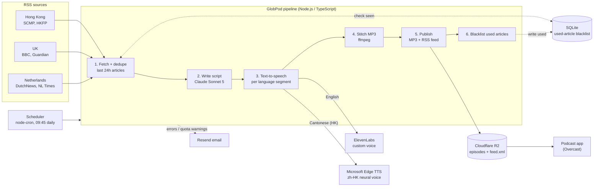

# GlobPod

Personal AI-powered morning news podcast. Fetches RSS from Hong Kong, UK, and the Netherlands, writes a bilingual script with Claude, speaks English with ElevenLabs and Hong Kong with Microsoft Edge Cantonese voices, and publishes a private podcast RSS feed on Cloudflare R2.

## Architecture



**Why two TTS providers?** ElevenLabs has no Cantonese support (Chinese text is read as Mandarin), so the Hong Kong section uses Microsoft Edge's `zh-HK` voices and is stitched together with the English parts.

## Requirements

- Node.js 24 (see `.nvmrc`) — `better-sqlite3` does not build on Node 26 yet
- Accounts/keys for: Anthropic, ElevenLabs, Cloudflare R2, Resend

## Setup

```bash
npm install
cp .env.example .env
# fill in .env
npm run build
```

## Commands

| Command | What it does |
|---|---|
| `npm run dev` | Run the pipeline once from TypeScript (`tsx`) |
| `npm run build` | Compile to `dist/` |
| `npm run run-once` | Run the compiled pipeline once |
| `npm start` | Start the daily scheduler (default **09:45** local; set `PIPELINE_CRON` in `.env`) |
| `npx tsx src/regenFeed.ts` | Rebuild channel metadata on the live feed (keeps episodes) |
| `npx tsx src/uploadHomepage.ts` | Upload the minimal HTML homepage required by feed validators |

## Pipeline

1. Purge SQLite rows older than 7 days
2. Fetch 6 RSS feeds (last 24h), skip articles already used in a published episode
3. Skip the run if fewer than `MIN_ARTICLES_FOR_EPISODE` (default 5) new articles
4. Claude writes a 10–15 min script (HK in Cantonese, UK/NL in English) + episode blurb + used article IDs
5. Check ElevenLabs quota; email a warning at ≥80%
6. TTS per segment → stitch MP3 (English: ElevenLabs; Cantonese HK: Edge `zh-HK-*`)
7. Upload MP3 + updated RSS to R2
8. Blacklist only the articles used in that published episode

Private feed URL:

```
${CF_R2_PUBLIC_URL}/feed/${FEED_SECRET_TOKEN}.xml
```

## Notes

- Daily auto-runs are **not** configured yet (see LIV-7). Prefer `npm run dev` until hosting is decided.
- Cover art and owner email still have placeholders/defaults in `src/config/podcast.ts` — override with `PODCAST_COVER_URL` / `PODCAST_OWNER_EMAIL` (see LIV-10).
- Dedup IDs are namespaced as `FeedName:guid` and only written after a successful publish (LIV-8).
